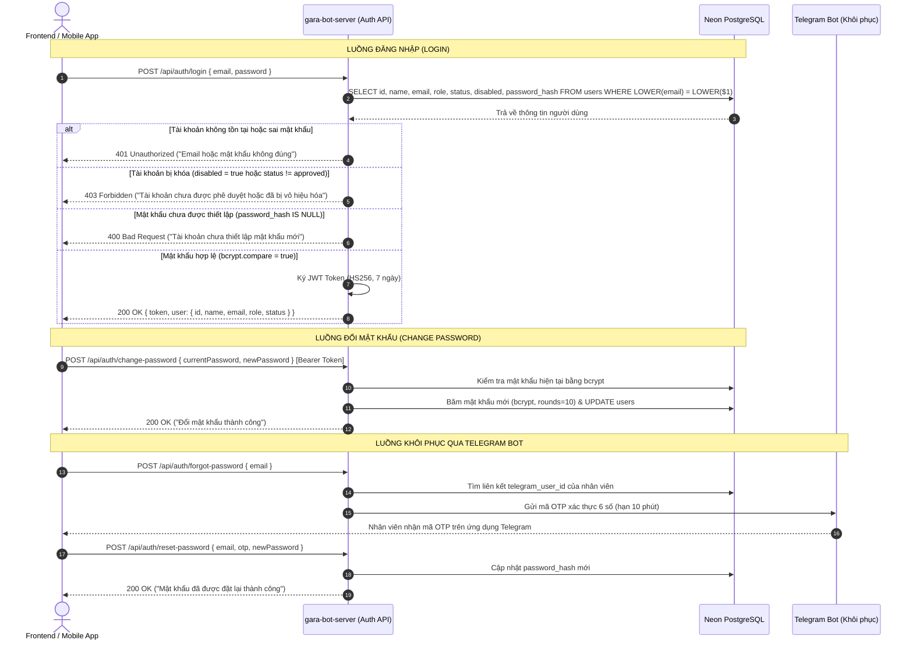

# BÁO CÁO PHÂN TÍCH & CHIẾN LƯỢC CHUYỂN ĐỔI HỆ THỐNG XÁC THỰC (AUTH MIGRATION REPORT)
**Dự án:** VT AUTO (`gara-manager`)  
**Mục tiêu:** Chuyển đổi toàn diện cơ chế xác thực từ Supabase Auth (GoTrue) sang Hệ thống Xác thực Độc lập (Node.js/Express JWT + Neon PostgreSQL).  
**Thời gian lập báo cáo:** 22/11/2026  
**Trạng thái:** Đã hoàn thành khảo sát, phân tích schema, rà soát dữ liệu sao lưu và thiết kế kiến trúc xác thực mới.

---

## 1. Phân tích Chi tiết Bảng `users` trên Neon PostgreSQL

Hiện tại cơ sở dữ liệu Neon đã khôi phục đầy đủ cấu trúc và 7 tài khoản nhân sự thật từ bản sao lưu `backups/users_rows.sql`.

### 1.1. Cấu trúc Schema bảng `public.users`

| Tên Cột | Kiểu Dữ Liệu | Ràng Buộc / Mặc Định | Ý Nghĩa Nghiệp Vụ & Xác Thực |
|---|---|---|---|
| `id` | `UUID` | `PRIMARY KEY DEFAULT gen_random_uuid()` | Khóa chính duy nhất định danh người dùng trong toàn bộ nghiệp vụ (tasks, attendance, logs). |
| `auth_id` | `TEXT` | `UNIQUE NULLABLE` | Mã định danh người dùng từ hệ thống cũ (`auth.users.id` của Supabase GoTrue). Hiện đóng vai trò liên kết đối soát. |
| `name` | `TEXT` | `NOT NULL` | Họ và tên đầy đủ của nhân sự / quản trị viên. |
| `email` | `TEXT` | `UNIQUE NOT NULL` | **Tên đăng nhập chính (Username/Credential Identifier)**. Duy nhất, viết thường. |
| `role` | `user_role` (`ENUM`) | `NOT NULL DEFAULT 'staff'` | Phân quyền hệ thống: `'admin'` hoặc `'staff'`. |
| `is_admin` | `BOOLEAN` | `NOT NULL DEFAULT false` | Cờ phụ đánh dấu quyền quản trị cấp cao. |
| `status` | `user_status` (`ENUM`) | `NOT NULL DEFAULT 'pending'` | Trạng thái phê duyệt: `'pending'`, `'approved'`, `'rejected'`. Chỉ tài khoản `'approved'` mới được phép đăng nhập. |
| `disabled` | `BOOLEAN` | `NOT NULL DEFAULT false` | Khóa tài khoản khẩn cấp: nếu `true`, chặn mọi quyền truy cập ngay lập tức. |
| `passkey_enabled`| `BOOLEAN` | `NOT NULL DEFAULT false` | Cờ bật xác thực sinh trắc học / WebAuthn. |
| `password_hash` | `TEXT` | `NULLABLE` | Chuỗi mã hóa mật khẩu theo thuật toán bảo mật `bcrypt`. |
| `phone` | `TEXT` | `NULLABLE` | Số điện thoại liên hệ. |
| `avatar` | `TEXT` | `NULLABLE` | Đường dẫn ảnh đại diện. |
| `created_at` | `TIMESTAMPTZ` | `NOT NULL DEFAULT now()` | Thời gian tạo tài khoản. |
| `updated_at` | `TIMESTAMPTZ` | `NOT NULL DEFAULT now()` | Thời gian cập nhật gần nhất. |

### 1.2. Thống kê 7 Tài khoản Thực tế Hiện có trên Neon (ĐÃ CẬP NHẬT MẬT KHẨU THÀNH CÔNG)

| STT | UUID (`id`) | Họ và tên (`name`) | Email Đăng nhập | Vai trò (`role`) | Trạng thái (`status`) | Khóa (`disabled`) | Tình trạng Mật khẩu |
|---|---|---|---|---|---|---|---|
| 1 | `5952c302-6998-4804-8121-80a663c81fb5` | LƯU VĂN VIỆT | `luuviet2810@gmail.com` | `admin` | `approved` | `false` | **Đã có (Bcrypt 60 ký tự)** |
| 2 | `fac02d82-116b-4476-a723-4cfc1f428a3c` | LƯU VIỆT TIẾN | `tienvietluu@gmail.com` | `admin` | `approved` | `false` | **Đã có (Bcrypt 60 ký tự)** |
| 3 | `41614ffc-d3a6-405a-ad88-14e3df8e6524` | Nguyễn thế đạt | `thedatjd2802@gmail.com` | `staff` | `approved` | `false` | **Đã có (Bcrypt 60 ký tự)** |
| 4 | `68acd1cf-cff9-4893-bc87-7eb8956c4a5d` | LUU VIET NV | `vietluukr@gmail.com` | `staff` | `approved` | `false` | **Đã có (Bcrypt 60 ký tự)** |
| 5 | `b2931df6-022c-403c-965d-9d743326b9f0` | LUU ANH KIEN | `kienluu13012005vp@gmail.com` | `staff` | `approved` | `false` | **Đã có (Bcrypt 60 ký tự)** |
| 6 | `47406eec-d8dd-4e84-8271-a78b62aea291` | Nguyễn Đình Tuấn | `nguyendinhtuan160504@gmail.com` | `staff` | `approved` | `false` | **Đã có (Bcrypt 60 ký tự)** |
| 7 | `37471124-e9fe-43f8-aa25-05529adb9b46` | Anh Thư | `linhthu.neu@gmail.com` | `staff` | `rejected` | `false` | **Đã có (Bcrypt 60 ký tự)** |

> [!NOTE]
> Bảng `users` hiện tại có 2 tài khoản quản trị viên (`admin`) và 5 tài khoản nhân sự (`staff`). Toàn bộ 7/7 tài khoản đã được nạp password hash chuẩn `$2a$` nguyên gốc từ Supabase qua transaction nguyên tử. Trạng thái `rejected` của tài khoản `linhthu.neu@gmail.com` được bảo toàn nghiêm ngặt.

---

## 2. Kết quả Rà soát Dữ liệu `auth.users` Cũ & Bản Sao Lưu

Chúng tôi đã kiểm tra toàn diện tất cả các file sao lưu trong thư mục `backups/` và toàn bộ mã nguồn dự án:
1. **File `backups/users_rows.sql`:** Chỉ chứa dữ liệu được xuất từ bảng ứng dụng công khai `public.users`.
2. **Kiến trúc Supabase GoTrue Auth:** 
   - Trong kiến trúc Supabase, thông tin xác thực nhạy cảm gồm `encrypted_password` (chuỗi mã hóa mật khẩu chuẩn bcrypt `$2a$` / `$2b$`) được lưu riêng biệt trong schema nội bộ `auth.users`.
   - Khi người dùng xuất bảng qua giao diện Supabase Table Editor / Studio, hệ thống chỉ xuất schema `public`, hoàn toàn **không kèm theo bảng `auth.users`**.
3. **Kết luận về Password Hash:**
   - Trong toàn bộ bản sao lưu hiện tại **KHÔNG tồn tại bản sao password hash** hay mật khẩu cũ.
   - Tuyệt đối không có mật khẩu dạng rõ (plaintext password).

---

## 3. Đánh giá Khả năng Giữ nguyên Mật khẩu Cũ vs. Thiết lập Mật khẩu Mới

### Phương án A: Giữ nguyên 100% Mật khẩu Cũ (Khuyên dùng nếu còn truy cập Supabase)
- **Cơ sở kỹ thuật:** Supabase GoTrue Auth sử dụng tiêu chuẩn mã hóa mật khẩu `bcrypt` (định dạng `$2a$...` hoặc `$2b$...`). Thư viện `bcrypt` / `bcryptjs` trên Node.js hoàn toàn tương thích và kiểm tra được chuỗi hash này mà không cần biết mật khẩu gốc.
- **Cách thực hiện:**
  1. Người dùng đăng nhập vào trang quản trị Supabase Dashboard của dự án cũ.
  2. Mở mục **SQL Editor** và chạy câu truy vấn trích xuất an toàn:
     ```sql
     SELECT id, email, encrypted_password FROM auth.users;
     ```
  3. Cung cấp file kết quả (chỉ chứa email/auth_id và encrypted_password) hoặc chạy lệnh cập nhật trực tiếp vào Neon:
     ```sql
     UPDATE public.users 
     SET password_hash = '<encrypted_password>'
     WHERE auth_id = '<auth_users_id>';
     ```
- **Ưu điểm:** Cả 7 người dùng (Admin và Staff) tiếp tục sử dụng mật khẩu quen thuộc từ trước đến nay, chuyển đổi hoàn toàn trong suốt không gây gián đoạn công việc.

### Phương án B: Thiết lập Quy trình Đặt Mật Khẩu Mới (Nếu không trích xuất từ Supabase)
Nếu không còn quyền truy vấn trực tiếp bảng `auth.users` trên Supabase:
- **Nguyên tắc bảo mật:**
  - Tuyệt đối **không tự tạo mật khẩu giả hoặc mật khẩu mặc định yếu** cho nhân viên.
  - Không thay đổi hoặc xóa các tài khoản hiện tại.
- **Quy trình thực hiện:**
  1. **Khởi tạo mật khẩu Quản trị viên (Admin First-Time Setup):**
     - Quản trị viên (Anh Việt) chạy một script CLI an toàn từ console backend để tự đặt mật khẩu mạnh cho tài khoản `luuviet2810@gmail.com`.
  2. **Thiết lập mật khẩu Nhân sự (Staff Setup):**
     - *Cách 1 (Qua Telegram Bot nội bộ VT AUTO):* Hệ thống `gara-bot-server` đã tích hợp sẵn Telegram Bot. Nhân viên gửi lệnh `/reset_password` hoặc nhận mã OTP xác thực qua Bot Telegram để tự đặt mật khẩu mới.
     - *Cách 2 (Admin cấp link kích hoạt một lần):* Quản trị viên vào trang Quản lý Nhân sự (`/employees`), bấm "Gửi link kích hoạt / Đặt mật khẩu" -> Hệ sinh mã một lần (One-Time Token có hạn 24h) để nhân viên tự đặt mật khẩu khi vào hệ thống mới.

---

## 4. Kiểm tra Kiến trúc JWT & Phân quyền Backend (`gara-bot-server`)

Hạ tầng xác thực độc lập đã được xây dựng nền móng trong `gara-bot-server` với các thông số:

| Thành phần | Cấu hình Hiện tại | Đánh giá & Khuyến nghị |
|---|---|---|
| **Thời hạn Token (`expiresIn`)** | `7d` (7 ngày) | Phù hợp với nhân viên gara làm việc theo ca trên thiết bị di động/máy tính bảng, tránh việc bị ngắt phiên liên tục. Sau này có thể bổ sung cơ chế Refresh Token xoay vòng (rotating refresh tokens). |
| **Thuật toán Ký (`algorithm`)** | `HS256` (HMAC SHA-256) | Chuẩn công nghiệp cho hệ thống microservice/monolith nội bộ. |
| **Cấu trúc Payload JWT** | `{ id, name, email, role, status }` | Nhỏ gọn, chứa đầy đủ thông tin định danh và phân quyền cơ bản để middleware xử lý mà không cần query lại database ở mỗi request. |
| **Bảo mật Khóa Ký (`JWT_SECRET`)** | Đọc từ `process.env.JWT_SECRET` | Đã cấu hình độc lập qua biến môi trường. Trên môi trường production, biến này cần được đặt một chuỗi ngẫu nhiên có độ dài tối thiểu 32 ký tự (256-bit entropy). |
| **Middleware Xác thực (`authenticateJwt`)** | Đọc header `Bearer <token>` | Đã phân tách rành mạch: bắt lỗi `TokenExpiredError` (mã HTTP 401, error: `token_expired`) và token giả mạo (error: `invalid_token`). |
| **Middleware Phân quyền Admin (`requireAdmin`)** | Kiểm tra `req.user.role === 'admin'` | Chặn đứng các hành động nhạy cảm (duyệt nhân viên, xóa xe, sửa cấu hình hệ thống), trả về HTTP 403 `forbidden`. |
| **Middleware Nhân viên & Admin (`requireStaffOrAdmin`)** | Chấp nhận `admin` hoặc `staff` | Cho phép truy cập nghiệp vụ gara (checksheet, chuyển xe, nhận task). |
| **Cơ chế Khóa Tài khoản Khẩn cấp** | Kiểm tra `status` và `disabled` | Nếu `disabled = true` hoặc `status` là `'disabled'`/`'rejected'`, middleware RBAC lập tức từ chối với HTTP 403 `account_inactive`. |

---

## 5. Đề xuất Kiến trúc API Xác thực Hoàn chỉnh



### Chi tiết các Endpoint Đề xuất Triển khai:

1. **`POST /api/auth/login`**:
   - Nhận `{ email, password }`.
   - Kiểm tra `status = 'approved'` và `disabled = false`.
   - So khớp mật khẩu qua `bcrypt.compare`.
   - Trả về Access Token JWT và thông tin hồ sơ người dùng.
2. **`GET /api/auth/me`** (Đã có nền tảng):
   - Header: `Authorization: Bearer <token>`.
   - Trả về thông tin phiên làm việc hiện tại của người dùng.
3. **`POST /api/auth/change-password`**:
   - Yêu cầu người dùng đang đăng nhập.
   - Xác thực mật khẩu cũ và cập nhật mật khẩu mới băm bằng `bcrypt`.
4. **`POST /api/auth/admin/reset-user-password`**:
   - Chỉ dành riêng cho Quản trị viên (`requireAdmin`).
   - Cho phép Admin trực tiếp cấp lại mật khẩu hoặc sinh link kích hoạt cho nhân sự khi nhân sự quên mật khẩu.
5. **`POST /api/auth/logout`**:
   - Phía Client xóa token khỏi bộ nhớ trình duyệt (`localStorage`).
   - Phía Server ghi nhận log đăng xuất.

---

## 6. Các Hành động Cần Người Dùng Thực Hiện Tiếp Theo

Để tiến hành hoàn thiện hệ thống xác thực mà không làm gián đoạn vận hành, xin vui lòng xác nhận và lựa chọn các bước sau:

1. **Xác nhận Phương án Mật khẩu Cũ:**
   - **Lựa chọn 1 (Khuyên dùng):** Nếu bạn còn truy cập được Supabase Project Dashboard cũ, hãy mở **SQL Editor** và chạy lệnh:
     ```sql
     SELECT id, email, encrypted_password FROM auth.users;
     ```
     Sau đó thông báo cho tôi để nạp trực tiếp toàn bộ password hash tương thích vào Neon. Tất cả 7 nhân viên và quản trị viên sẽ tiếp tục dùng mật khẩu cũ như bình thường.
   - **Lựa chọn 2:** Nếu bạn muốn thiết lập lại mật khẩu mới cho toàn bộ nhân sự, hãy xác nhận để tôi tạo script thiết lập mật khẩu khởi tạo cho tài khoản Admin của bạn (`luuviet2810@gmail.com`).
2. **Thiết lập chuỗi bí mật `JWT_SECRET`:**
   - Vui lòng cung cấp hoặc xác nhận việc tạo một chuỗi bí mật ngẫu nhiên mạnh (32+ ký tự) lưu trong file `.env` của `gara-bot-server`.
3. **Cài đặt thư viện `bcryptjs` vào Backend:**
   - Xác nhận cài đặt package `bcryptjs` và `@types/bcryptjs` vào `gara-bot-server` để thực hiện xử lý băm và kiểm tra mật khẩu an toàn.
