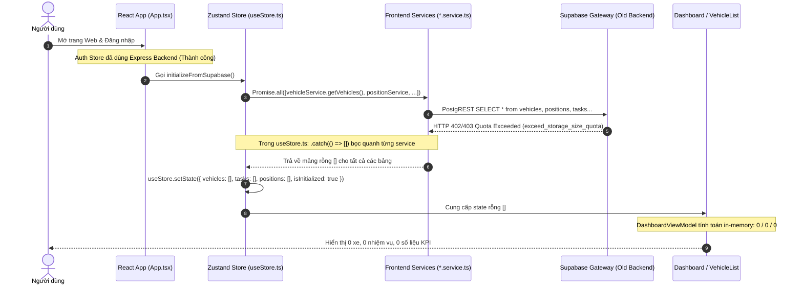
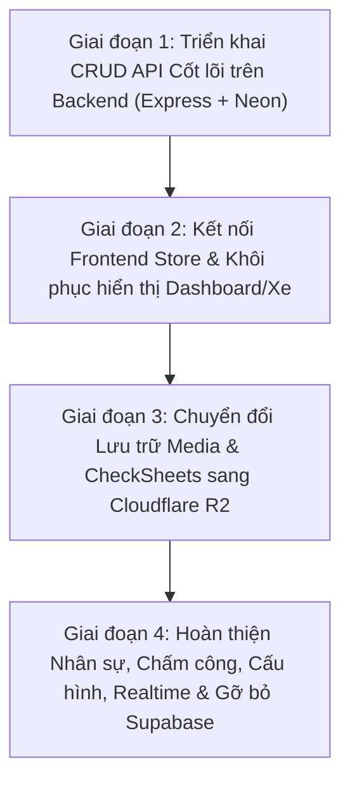

# BÁO CÁO KHẢO SÁT TOÀN DIỆN DATA SERVICES & LUỒNG DỮ LIỆU VT AUTO (DATABASE SERVICES AUDIT)

**Dự án:** VT AUTO (`gara-manager`)  
**Ngày thực hiện:** 22/11/2026  
**Mục tiêu:** Khảo sát toàn bộ luồng dữ liệu từ React Frontend đến Express Backend và Neon PostgreSQL, xác định chính xác nguyên nhân Dashboard và danh sách xe hiển thị 0 số liệu, và xây dựng bản đồ chuyển đổi an toàn sang Neon + Cloudflare R2.

---

## 1. KIỂM TRA DỮ LIỆU THỰC TẾ TRÊN NEON POSTGRESQL

Kiểm tra trực tiếp trên CSDL Neon (`autumn-dream-42270306`, branch `production`) bằng `pg.Pool`:

| STT | Tên Bảng / View | Loại | Số bản ghi thực tế | Đối soát Import Reports | Đánh giá toàn vẹn |
|:---:|---|:---:|:---:|:---:|---|
| 1 | `users` | Table | **7** | 7 (DATA_IMPORT_REPORT) | ✅ 100% Khớp (2 Admin, 5 Staff) |
| 2 | `vehicles` | Table | **109** | 109 (DATA_IMPORT_REPORT) | ✅ 100% Khớp (36 available, 73 sold) |
| 3 | `check_sheets` | Table | **116** | 116 (DATA_IMPORT_REPORT) | ✅ 100% Khớp |
| 4 | `tasks` | Table | **213** | 213 (DATA_IMPORT_HISTORY_REPORT) | ✅ 100% Khớp (128 todo, 83 done, 2 doing) |
| 5 | `vehicle_images` | Table | **749** | 749 (DATA_IMPORT_REPORT) | ✅ 100% Khớp metadata |
| 6 | `vehicle_documents` | Table | **3** | 3 (DATA_IMPORT_HISTORY_REPORT) | ✅ 100% Khớp metadata |
| 7 | `move_logs` | Table | **184** | 184 (DATA_IMPORT_HISTORY_REPORT) | ✅ 100% Khớp |
| 8 | `vehicle_workflow_logs`| Table | **144** | 144 (DATA_IMPORT_HISTORY_REPORT) | ✅ 100% Khớp (116 working, ...) |
| 9 | `positions` | Table | **7** | 7 (DATA_IMPORT_REPORT) | ✅ 100% Khớp (5 seed + 2 bãi thực tế) |
| 10 | `attendance` | Table | **1** | 1 (DATA_IMPORT_HISTORY_REPORT) | ✅ 100% Khớp |
| 11 | `vehicle_option_defs` | Table | **16** | 16 (SEED_IMPORT_REPORT) | ✅ 100% Khớp danh mục chuẩn |
| 12 | `website_settings` | Table | **1** | 1 (SEED_IMPORT_REPORT) | ✅ 100% Khớp cấu hình website |
| 13 | `settings` | Table | **1** | 1 (DATA_IMPORT_HISTORY_REPORT) | ✅ 100% Khớp cấu hình chung |
| 14 | `public_vehicles` | View | **26** | 26 (DATA_IMPORT_REPORT) | ✅ 100% Khớp (xe public chưa bán) |
| 15 | `public_vehicle_images` | View | **371** | 371 (DATA_IMPORT_REPORT) | ✅ 100% Khớp (ảnh public tương ứng) |

> [!NOTE]
> **Kết luận dữ liệu Neon:** Dữ liệu nghiệp vụ trên Neon hoàn toàn nguyên vẹn 100%, bảo toàn đầy đủ các quan hệ Foreign Key, UUID, Timestamp và JSONB. Không có bất kỳ bản ghi nào bị mất mát hay hư hỏng.

---

## 2. NGUYÊN NHÂN GỐC RỄ: TẠI SAO DASHBOARD VÀ DANH SÁCH XE HIỂN THỊ 0?

### Chuỗi sự kiện gây lỗi (Failure Chain):



### Chi tiết kỹ thuật:
1. **Frontend Auth đã tách rời thành công:** `useAuthStore.ts` gọi `http://localhost:3001/api/auth/login` và `/me`, xác thực thành công JWT và vai trò với CSDL Neon.
2. **Data Services chưa chuyển đổi:** Toàn bộ 16 service trong `src/services/` (ngoại trừ `auth.service.ts`) vẫn đang import `supabase` từ `src/lib/supabase.ts`.
3. **Cơ chế bọc lỗi im lặng (Silent Fallback):**
   Trong `src/store/useStore.ts` (dòng 71-79):
   ```typescript
   const [vehicles, positions, employees, tasks, checkSheets, attendance, moveLogs] = await Promise.all([
     vehicleService.getVehicles().catch(() => []),
     positionService.getPositions().catch(() => []),
     usersService.getEmployees().catch(() => []),
     taskService.getTasks().catch(() => []),
     checksheetService.getCheckSheets().catch(() => []),
     attendanceService.getAttendanceEntries().catch(() => []),
     moveLogService.getMoveLogs().catch(() => []),
   ])
   ```
   Khi dự án Supabase cũ bị khóa do hạn ngạch lưu trữ (`exceed_storage_size_quota`), mọi truy vấn API PostgREST đều bị từ chối. Lệnh `.catch(() => [])` nuốt toàn bộ ngoại lệ và gán mảng rỗng `[]` vào Zustand Store.
4. **Dashboard tính toán từ Store:**
   Component `OverviewDashboard.tsx` sử dụng hook `useDashboardViewModel()` (`src/pages/dashboards/dashboard/DashboardViewModel.ts`). Hook này tính toán toàn bộ chỉ số KPI, thống kê và danh sách xe trực tiếp trong bộ nhớ (in-memory) từ `useStore.getState().vehicles`, `.tasks`, `.checkSheets`.
   Vì `vehicles = []` và `tasks = []`, toàn bộ phép tính trả về `0`.
5. **Backend chưa có REST API nghiệp vụ:**
   `gara-bot-server` hiện mới chỉ có các endpoint Auth (`/api/auth/*`), Storage Presigned URL (`/api/storage/*`) và Telegram (`/api/telegram/*`). Chưa có các Controller và Routes để phục vụ dữ liệu nghiệp vụ (Vehicles, Tasks, CheckSheets, Positions, Employees, Attendance, MoveLogs) từ Neon.

---

## 3. RÀ SOÁT CHI TIẾT CÁC FRONTEND SERVICES & NƠI GỌI DỮ LIỆU

Dự án có **18 vị trí** đang liên kết trực tiếp tới `src/lib/supabase.ts`:

| STT | File nguồn | Các bảng / API Supabase được gọi | Tác vụ chính |
|:---:|---|---|---|
| 1 | `src/services/vehicle.service.ts` | `vehicles`, `vehicle_images`, `vehicle_documents` | `getVehicles`, `getVehicleById`, `getVehicleByPlate`, `createVehicle`, `updateVehicle`, `deleteVehicle`, `moveVehicle`, `upsertVehicle` |
| 2 | `src/services/vehicleMedia.service.ts` | `vehicle_images`, `vehicle_documents` | `addVehicleImage`, `getVehicleImages`, `deleteVehicleImage`, `updateVehicleImageOrder`, `updateVehicleImageCategory`, `updateVehicleImageExpiry`, `addVehicleDocument`, `getVehicleDocuments`, `deleteVehicleDocument`, `deleteAllVehicleMedia` |
| 3 | `src/services/storage.service.ts` | `supabase.storage.from('vehicle-images')`, `from('vehicle-documents')` | Upload & Delete file ảnh/tài liệu lên Supabase Storage |
| 4 | `src/services/checksheet.service.ts` | `check_sheets`, `checksheet_logs` | `getCheckSheets`, `getCheckSheetsByVehicle`, `getCheckSheetById`, `createCheckSheet`, `updateCheckSheet`, `getOrCreateCheckSheet`, `deleteCheckSheet` |
| 5 | `src/services/task.service.ts` | `tasks`, `task_activity_logs` | `getTasks`, `createTask`, `updateTask`, `deleteTask`, `getTaskActivity`, `getAllTaskActivity`, `addTaskActivity` |
| 6 | `src/services/moveLog.service.ts` | `move_logs` | `getMoveLogs`, `getMoveLogsByVehicle`, `createMoveLog` |
| 7 | `src/services/vehicleWorkflow.service.ts` | `vehicle_workflow_logs` | `getVehicleWorkflowLogs`, `addVehicleWorkflowLog` |
| 8 | `src/services/position.service.ts` | `positions` | `getPositions`, `getPositionById`, `createPosition`, `updatePosition`, `deletePosition`, `reorderPositions` |
| 9 | `src/services/users.service.ts` | `users` | `getEmployees`, `getEmployeeById`, `updateEmployee`, `deleteEmployee` |
| 10 | `src/services/attendance.service.ts` | `attendance` | `getAttendanceEntries`, `getAttendanceByDate`, `getAttendanceByEmployee`, `createAttendanceEntry`, `updateAttendanceEntry`, `deleteAttendanceEntry`, `findOrCreateTodayEntry`, `checkIn`, `checkOut` |
| 11 | `src/services/vehicleOption.service.ts` | `vehicle_option_defs` | `getVehicleOptionDefs`, `createOptionDef`, `updateOptionDefLabel`, `deleteOptionDef` |
| 12 | `src/services/websiteSettings.service.ts`| `website_settings` | `getWebsiteSettings`, `updateWebsiteSettings` |
| 13 | `src/services/notification.service.ts` | `notifications` | `createEvent`, `getNotifications`, `markNotificationRead`, `markAllNotificationsRead`, `deleteNotification` |
| 14 | `src/services/realtime.service.ts` | Realtime Channels (8 tables: `vehicles`, `tasks`, `positions`, `move_logs`, `task_activity_logs`, `vehicle_images`, `vehicle_documents`, `notifications`) | Lắng nghe sự kiện INSERT, UPDATE, DELETE qua Supabase Realtime WebSocket |
| 15 | `src/pages/Employees.tsx` | `supabase.from('users')` trực tiếp qua dynamic import | Duyệt nhân viên, thay đổi role, bật/tắt disabled, duyệt tài khoản |
| 16 | `src/public/publicApi.ts` | `public_vehicles`, `public_vehicle_images`, `vehicle_option_defs` | API đọc công khai dành cho khách xem website showroom |
| 17 | `src/services/publicWeb.service.ts` | `public_vehicles`, `public_vehicle_images`, `vehicle_images` | Quản lý danh sách xe và ảnh trên trang giới thiệu bán xe |
| 18 | `src/services/locationService.ts` | `locations` | File service cũ (hiện không còn component nào sử dụng, dự án đã chuyển sang `position.service.ts`) |

---

## 4. HIỆN TRẠNG BACKEND API (`gara-bot-server`)

### Các Endpoint hiện có:
- **Health Check:**
  - `GET /health`: Kiểm tra tổng thể hệ thống
  - `GET /health/database`: Ping Neon PostgreSQL (đo latency, kiểm tra kết nối `pg.Pool`)
  - `GET /health/storage`: Kiểm tra kết nối Cloudflare R2 và 3 buckets
- **Authentication:**
  - `POST /api/auth/login`: Đăng nhập bằng email/password (xác minh hash bcrypt trên Neon)
  - `GET /api/auth/me`: Lấy thông tin user hiện tại qua JWT
  - `GET /api/auth/admin-check`: Kiểm tra quyền Admin
  - `POST /api/auth/logout`: Đăng xuất (xóa cookie)
  - `GET /api/auth/verify`: Xác minh tính hợp lệ của token
- **Storage Presigned URL (Cloudflare R2):**
  - `POST /api/storage/presigned-upload`: Cấp link S3 presigned PUT URL để client upload trực tiếp lên R2
  - `POST /api/storage/presigned-download`: Cấp link presigned GET URL để client tải file bảo mật
- **Telegram Webhook & Dispatcher:**
  - `/api/telegram/*`: Toàn bộ các luồng webhook và xử lý thông báo Telegram của gara

### Các API còn thiếu để phục vụ nghiệp vụ (Missing REST Endpoints):
1. **Xe & Phương tiện:** `GET /api/vehicles`, `GET /api/vehicles/:id`, `POST /api/vehicles`, `PUT /api/vehicles/:id`, `DELETE /api/vehicles/:id`, `POST /api/vehicles/:id/move`, `POST /api/vehicles/upsert`
2. **Phiếu kiểm tra:** `GET /api/checksheets`, `GET /api/checksheets/:id`, `POST /api/checksheets`, `PUT /api/checksheets/:id`, `DELETE /api/checksheets/:id`
3. **Công việc kỹ thuật:** `GET /api/tasks`, `POST /api/tasks`, `PUT /api/tasks/:id`, `DELETE /api/tasks/:id`, `GET /api/tasks/:id/activity`, `POST /api/tasks/:id/activity`
4. **Vị trí bãi đỗ:** `GET /api/positions`, `POST /api/positions`, `PUT /api/positions/:id`, `DELETE /api/positions/:id`, `PUT /api/positions/reorder`
5. **Nhân sự & Phân quyền:** `GET /api/employees`, `GET /api/employees/:id`, `PUT /api/employees/:id`, `DELETE /api/employees/:id`
6. **Lịch sử di chuyển xe:** `GET /api/move-logs`, `POST /api/move-logs`
7. **Lịch sử quy trình xe:** `GET /api/workflow-logs/:vehicleId`, `POST /api/workflow-logs`
8. **Chấm công:** `GET /api/attendance`, `POST /api/attendance/check-in`, `POST /api/attendance/check-out`, `PUT /api/attendance/:id`
9. **Cấu hình & Tùy chọn xe:** `GET /api/vehicle-options`, `POST /api/vehicle-options`, `PUT /api/vehicle-options/:id`, `DELETE /api/vehicle-options/:id`, `GET /api/website-settings`, `PUT /api/website-settings`, `GET /api/settings`, `PUT /api/settings`
10. **Quản lý Metadata Ảnh & Tài liệu:** `GET /api/vehicles/:id/media`, `POST /api/vehicles/:id/images`, `PUT /api/images/:id`, `DELETE /api/images/:id`, `POST /api/vehicles/:id/documents`, `DELETE /api/documents/:id`
11. **Thông báo nội bộ:** `GET /api/notifications`, `POST /api/notifications`, `PUT /api/notifications/:id/read`, `PUT /api/notifications/read-all`, `DELETE /api/notifications/:id`
12. **Showroom công khai:** `GET /api/public/vehicles`, `GET /api/public/vehicles/:id`, `GET /api/public/settings`

---

## 5. BẢNG TỔNG HỢP CHI TIẾT CÁC MODULE THEO YÊU CẦU

| Module | Nguồn hiện tại | Dữ liệu Neon | API Backend | Trạng thái | Việc cần làm |
|---|---|:---:|---|:---:|---|
| **1. Xe (Vehicles)** | `src/services/vehicle.service.ts` (`supabase.from('vehicles')`) | **109** bản ghi (36 available, 73 sold) | Chưa có | 🔴 Bị chặn (Supabase quota -> trả về `[]`) | Xây dựng CRUD `/api/vehicles` trên Express + Neon; chuyển `vehicle.service.ts` sang gọi API backend. |
| **2. Bảng kiểm tra xe (Check Sheets)** | `src/services/checksheet.service.ts` (`supabase.from('check_sheets')`) | **116** bản ghi | Chưa có | 🔴 Bị chặn (Supabase quota -> trả về `[]`) | Xây dựng CRUD `/api/checksheets` trên Express; chuyển `checksheet.service.ts` sang gọi API backend. |
| **3. Công việc kỹ thuật (Tasks)** | `src/services/task.service.ts` (`supabase.from('tasks')`) | **213** bản ghi (128 todo, 83 done, 2 doing) | Chưa có | 🔴 Bị chặn (Supabase quota -> trả về `[]`) | Xây dựng CRUD `/api/tasks` và activity logs trên Express; chuyển `task.service.ts` sang gọi API backend. |
| **4. Hình ảnh xe (Vehicle Images)** | `src/services/vehicleMedia.service.ts` (`vehicle_images`) & `storage.service.ts` | **749** bản ghi metadata | Đã có Presigned URL R2; Chưa có REST API metadata | ⚠️ Metadata bị chặn; Upload Supabase lỗi | Xây dựng API quản lý metadata `vehicle_images`; cấu hình `storage.service.ts` upload thẳng vào Cloudflare R2 qua Presigned URL. |
| **5. Tài liệu xe (Vehicle Documents)** | `src/services/vehicleMedia.service.ts` (`vehicle_documents`) & `storage.service.ts` | **3** bản ghi metadata | Đã có Presigned URL R2; Chưa có REST API metadata | ⚠️ Metadata bị chặn; Upload Supabase lỗi | Xây dựng API quản lý metadata `vehicle_documents`; cấu hình upload tài liệu lên Cloudflare R2 bucket `vehicle-documents`. |
| **6. Lịch sử di chuyển (Move Logs)** | `src/services/moveLog.service.ts` (`supabase.from('move_logs')`) | **184** bản ghi | Chưa có | 🔴 Bị chặn (Supabase quota -> trả về `[]`) | Xây dựng API `/api/move-logs` trên Express; chuyển `moveLog.service.ts` sang gọi API backend. |
| **7. Lịch sử quy trình xe (Workflow Logs)** | `src/services/vehicleWorkflow.service.ts` (`vehicle_workflow_logs`) | **144** bản ghi (116 working, ...) | Chưa có | 🔴 Bị chặn (Supabase quota -> trả về `[]`) | Xây dựng API `/api/workflow-logs` trên Express; chuyển `vehicleWorkflow.service.ts` sang gọi API backend. |
| **8. Nhân viên & Chức vụ (Users & Positions)** | `src/services/users.service.ts`, `position.service.ts`, `Employees.tsx` | **7** users, **7** positions | Đã có `/api/auth/me`; Chưa có CRUD nhân sự & positions | ⚠️ Đăng nhập OK; Danh sách nhân sự & vị trí rỗng | Xây dựng CRUD `/api/positions` và `/api/employees`; tái cấu trúc `Employees.tsx` không gọi Supabase trực tiếp. |
| **9. Chấm công (Attendance)** | `src/services/attendance.service.ts` (`supabase.from('attendance')`) | **1** bản ghi | Chưa có | 🔴 Bị chặn (Supabase quota -> trả về `[]`) | Xây dựng API `/api/attendance` (check-in, check-out, list) trên Express; chuyển `attendance.service.ts`. |
| **10. Cấu hình & Tùy chọn (Settings & Options)** | `vehicleOption.service.ts`, `websiteSettings.service.ts` | **16** options, **1** web settings, **1** settings | Chưa có | 🔴 Bị chặn (Supabase quota -> trả về `[]` hoặc null) | Xây dựng API cấu hình `/api/settings`, `/api/website-settings`, `/api/vehicle-options` trên Express; chuyển frontend services. |
| **11. Bảng điều khiển (Dashboard Overview, Stats, Staff)** | `OverviewDashboard.tsx`, `StatisticsDashboard.tsx`, `DashboardViewModel.ts` | Tính toán in-memory từ các bảng trên | Không cần API riêng (Frontend tự tính từ Store) | 🔴 Hiển thị 0 do `useStore` rỗng | Ngay khi các module dữ liệu nền (1, 2, 3, 6, 8, 9) được nạp vào `useStore`, Dashboard sẽ tự động hiển thị đúng 100% số liệu. |

---

## 6. ĐỀ XUẤT LỘ TRÌNH CHUYỂN ĐỔI AN TOÀN SANG NEON + EXPRESS API + CLOUDFLARE R2

Để đảm bảo an toàn tuyệt đối, không gây đứt gãy hệ thống và kiểm chứng được ngay kết quả từng bước, đề xuất lộ trình chuyển đổi gồm **4 giai đoạn tuần tự**:



### Giai đoạn 1: Xây dựng Bộ API Nghiệp vụ Cốt lõi trên Backend Express
- **Nhiệm vụ:**
  1. Tạo các controller và routes trên `gara-bot-server`:
     - `positions.controller.ts` & `positions.routes.ts`: Đọc danh sách vị trí bãi đỗ.
     - `vehicles.controller.ts` & `vehicles.routes.ts`: Đọc danh sách xe kèm metadata ảnh/tài liệu, chi tiết xe theo ID/Biển số, cập nhật vị trí xe.
     - `checksheets.controller.ts` & `checksheets.routes.ts`: Đọc danh sách phiếu kiểm tra xe vào/ra.
     - `tasks.controller.ts` & `tasks.routes.ts`: Đọc danh sách công việc kỹ thuật, trạng thái todo/done.
     - `moveLogs.controller.ts` & `moveLogs.routes.ts`: Đọc lịch sử di chuyển xe.
     - `employees.controller.ts` & `employees.routes.ts`: Đọc danh sách nhân viên công ty (ẩn password_hash).
  2. Tích hợp middleware xác thực JWT `authenticateJwt` và phân quyền RBAC.
  3. Kiểm thử endpoint trực tiếp bằng script/curl bảo đảm trả về đúng 109 xe, 116 phiếu kiểm tra, 213 nhiệm vụ từ Neon.

### Giai đoạn 2: Chuyển đổi Khởi tạo Frontend Store & Khôi phục Dashboard
- **Nhiệm vụ:**
  1. Xây dựng HTTP Client chuẩn `apiClient` có đính kèm JWT Token trong `src/services/api.client.ts`.
  2. Cập nhật các service frontend:
     - `position.service.ts`: Gọi `GET /api/positions`.
     - `vehicle.service.ts`: Gọi `GET /api/vehicles`.
     - `checksheet.service.ts`: Gọi `GET /api/checksheets`.
     - `task.service.ts`: Gọi `GET /api/tasks`.
     - `moveLog.service.ts`: Gọi `GET /api/move-logs`.
     - `users.service.ts`: Gọi `GET /api/employees`.
  3. Cập nhật hàm `initializeFromSupabase()` trong `src/store/useStore.ts` (đổi tên/hướng sang backend API).
- **Kết quả đạt được ngay:**
  - Danh sách xe (`VehicleList.tsx`) hiển thị đầy đủ 109 xe.
  - Bảng giá (`PriceList.tsx`) hiển thị đầy đủ dữ liệu giá và trạng thái xe.
  - Trang công việc (`Tasks.tsx`) hiển thị 213 nhiệm vụ (128 todo, 83 done, 2 doing).
  - Dashboard (`OverviewDashboard.tsx`) tính toán và hiển thị chính xác các thẻ KPI, cảnh báo ắc quy, rửa xe, đánh bóng và số liệu tổng quan.

### Giai đoạn 3: Chuyển đổi Lưu trữ Hình ảnh & Tài liệu sang Cloudflare R2
- **Nhiệm vụ:**
  1. Tích hợp quy trình tải lên ảnh/tài liệu qua Presigned URL:
     - Client yêu cầu Backend cấp Presigned Upload URL (`POST /api/storage/presigned-upload`).
     - Client PUT trực tiếp file lên Cloudflare R2.
     - Client gọi Backend lưu metadata bản ghi vào `vehicle_images` hoặc `vehicle_documents` trên Neon.
  2. Chuyển đổi `storage.service.ts` và `vehicleMedia.service.ts` sang sử dụng Cloudflare R2 và Backend API.
  3. Xây dựng cơ chế tải/xem ảnh qua R2 Public URL hoặc Presigned Download URL.

### Giai đoạn 4: Hoàn thiện Nghiệp vụ Còn lại, Realtime & Gỡ bỏ Hoàn toàn Supabase
- **Nhiệm vụ:**
  1. Hoàn thiện API Chấm công (`attendance`), Quy trình xe (`vehicle_workflow_logs`), Cấu hình (`settings`, `website_settings`, `vehicle_option_defs`).
  2. Tái cấu trúc trang `Employees.tsx` (gỡ bỏ các lệnh import `supabase` trực tiếp).
  3. Thay thế cơ chế Supabase Realtime bằng Polling định kỳ an toàn (30-60 giây) hoặc Server-Sent Events (SSE) trên Express Backend.
  4. Cập nhật Public Web API (`publicApi.ts`) để showroom khách hàng đọc trực tiếp từ Neon qua Express Backend.
  5. Gỡ bỏ hoàn toàn file `src/lib/supabase.ts` và dependency `@supabase/supabase-js`.

---

## 7. KẾT LUẬN & ĐỀ XUẤT BƯỚC TIẾP THEO

- **Hiện trạng:** Dữ liệu trên Neon PostgreSQL đã đầy đủ 100%. Cơ chế đăng nhập và xác thực đã vận hành trơn tru. Toàn bộ nguyên nhân gây ra số liệu bằng 0 đã được khoanh vùng chính xác (do lỗi quota của Supabase cũ chặn PostgREST và fallback mảng rỗng `[]` trong `useStore`).
- **Khuyến nghị:** Tiến hành ngay **Giai đoạn 1 & Giai đoạn 2** để đưa toàn bộ 109 xe, 213 nhiệm vụ và Dashboard hoạt động trở lại bình thường.

> [!IMPORTANT]
> **Cam kết:** Không có bất kỳ dòng code nào bị chỉnh sửa trong đợt khảo sát này. Vui lòng xem xét báo cáo và lộ trình trên. Khi bạn xác nhận đồng ý, chúng tôi sẽ tiến hành triển khai Giai đoạn 1.
