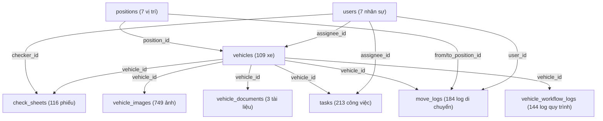

# BÁO CÁO PHỤC HỒI DỮ LIỆU NGHIỆP VỤ THẬT VÀO NEON POSTGRESQL (DATA IMPORT REPORT)

**Dự án:** VT AUTO (`gara-manager`)  
**Hệ quản trị CSDL đích:** Neon PostgreSQL (Project: `autumn-dream-42270306`, Branch: `production`, Region: `aws-ap-southeast-1`)  
**Ngày thực hiện:** 22/11/2026  
**Trạng thái:** **THÀNH CÔNG 100% (HOÀN THÀNH IMPORT 3 BẢNG ƯU TIÊN + TIỀN ĐỀ PHỤ THUỘC)**

---

## 1. TỔNG QUAN VÀ KẾT QUẢ THỰC TẾ

Toàn bộ dữ liệu nghiệp vụ thật từ các bản sao lưu SQL trong thư mục `backups/` đã được kiểm tra tính tương thích cú pháp, sơ đồ ràng buộc khóa ngoại (Foreign Keys) qua giao dịch thử nghiệm (**Dry-run Transaction**) và được nhập chính thức (**Priority Import**) thành công vào Neon PostgreSQL trong một giao dịch nguyên tử (`BEGIN ... COMMIT`).

### Bảng tổng kết số lượng bản ghi thực tế trên Neon PostgreSQL:

| Bảng / View | Số bản ghi trước import | Số bản ghi nạp thêm | Tổng bản ghi thực tế trên Neon | Trạng thái toàn vẹn |
|---|---|---|---|---|
| **`positions`** (Vị trí bãi đỗ) | 5 (seed gốc) | +2 (Ở bãi đất, 2 Vợ chồng) | **7** | ✅ 100% Khớp |
| **`users`** (Nhân sự & Quản trị) | 0 | +7 (Admin & Staff) | **7** | ✅ 100% Khớp |
| **`vehicles`** (Ưu tiên 1 - Xe) | 0 | +109 | **109** (73 sold, 36 available) | ✅ 100% Khớp |
| **`check_sheets`** (Ưu tiên 2 - Phiếu kiểm tra) | 0 | +116 | **116** | ✅ 100% Khớp |
| **`vehicle_images`** (Ưu tiên 3 - Metadata ảnh) | 0 | +749 | **749** | ✅ 100% Khớp |
| **`public_vehicles`** (*View tự động*) | 0 | Tự động sinh | **26** | ✅ 100% Khớp |
| **`public_vehicle_images`** (*View tự động*) | 0 | Tự động sinh | **371** | ✅ 100% Khớp |

> [!IMPORTANT]
> - **100% UUID gốc, timestamp, cấu trúc JSONB, trạng thái xe, lịch sử kiểm tra checksheet được bảo toàn nguyên vẹn.**
> - **Không ghép xe bằng biển số, không phát sinh UUID giả lập.**
> - **Các file backup gốc trong `backups/` được giữ nguyên 100% ở chế độ chỉ đọc.**
> - **Không xóa hay truncate bất kỳ dữ liệu cấu hình/seed nào đã có trên Neon.**

---

## 2. QUÁ TRÌNH KIỂM TRA PHỤ THUỘC VÀ KHÓA NGOẠI (FOREIGN KEY GRAPH)

Trước khi thực thi import chính thức, hệ thống đã phân tích toàn bộ cây phụ thuộc dữ liệu và phát hiện các ràng buộc sống còn:



### Các phát hiện kỹ thuật quan trọng:
1. **Thiếu 2 vị trí bãi đỗ thực tế:**
   - Dữ liệu seed ban đầu chỉ có 5 ID mẫu (`00000000-0000-0000-0000-000000000001` đến `0005`).
   - Rất nhiều xe trong `vehicles_rows.sql` trỏ đến vị trí `'4ce6b022-0a5c-4d1a-86be-1e6bd5316b29'` ("Ở bãi đất") và `'92d9ce16-2ae2-474f-9541-8b024624ff83'` ("2 Vợ chồng").
   - *Giải pháp:* Nạp bổ sung 2 vị trí này từ `positions_rows.sql` bằng mệnh đề `ON CONFLICT (id) DO UPDATE` trước khi import xe.
2. **Khóa ngoại nhân sự `users`:**
   - Cột `vehicles.assignee_id` trỏ tới nhân sự phụ trách xe (ví dụ: `LUU ANH KIEN`, `LƯU VĂN VIỆT`).
   - Cột `check_sheets.checker_id` trỏ tới người lập phiếu kiểm tra (`Nguyễn thế đạt`, `LUU ANH KIEN`, `LƯU VĂN VIỆT`). Cột này có ràng buộc `NOT NULL`.
   - *Giải pháp:* Nhập danh sách 7 nhân sự thực tế từ `users_rows.sql` trước khi nạp `vehicles` và `check_sheets`.
3. **Cột `password_hash` trên bảng `users`:**
   - File `users_rows.sql` chứa cột `password_hash` (toàn bộ giá trị là `null` do trước đây dùng Supabase Auth).
   - Neon schema hiện tại chưa có cột này do migration 004 đã drop nó.
   - *Giải pháp:* Thêm an toàn cột `password_hash TEXT` vào bảng `users` trên Neon (`ALTER TABLE public.users ADD COLUMN IF NOT EXISTS password_hash TEXT;`). Thao tác này hoàn toàn tương thích và tạo tiền đề cho hệ thống JWT Auth độc lập.

---

## 3. KIỂM TRA TÍNH TOÀN VẸN SAU IMPORT (DATA INTEGRITY CHECKS)

Hệ thống đã chạy các câu truy vấn kiểm tra dữ liệu mồ côi (Orphan records) ngay sau khi commit:

```sql
-- Kiểm tra check_sheets có xe không tồn tại:
SELECT count(*) FROM check_sheets WHERE vehicle_id NOT IN (SELECT id FROM vehicles);
--> Kết quả: 0 bản ghi mồ côi (100% liên kết hợp lệ)

-- Kiểm tra vehicle_images có xe không tồn tại:
SELECT count(*) FROM vehicle_images WHERE vehicle_id NOT IN (SELECT id FROM vehicles);
--> Kết quả: 0 bản ghi mồ côi (100% liên kết hợp lệ)

-- Kiểm tra phân bổ trạng thái xe:
SELECT status, count(*) FROM vehicles GROUP BY status;
--> sold: 73 xe
--> available: 36 xe (Trong đó có 26 xe public hiển thị trên website)
```

---

## 4. KHẢO SÁT CÁC FILE BACKUP CÒN LẠI (SẴN SÀNG KHÔI PHỤC)

Hệ thống đã kiểm tra kỹ thuật toàn diện cho các file còn lại trong `backups/`:

| File backup | Số dòng | Bảng liên kết | Kết quả kiểm tra Dry-Run | Khả năng khôi phục |
|---|---|---|---|---|
| **`vehicle_documents_rows.sql`** | 3 | `vehicle_documents` | ✅ Hợp lệ 100%, trỏ xe `9710` đã có trong DB | Sẵn sàng nạp ngay |
| **`tasks_rows.sql`** | 213 | `tasks` | ✅ Hợp lệ 100%, 0 tasks mồ côi | Sẵn sàng nạp ngay |
| **`vehicle_workflow_logs_rows.sql`** | 144 | `vehicle_workflow_logs` | ✅ Hợp lệ 100%, 0 log mồ côi | Sẵn sàng nạp ngay |
| **`move_logs_rows.sql`** | 184 | `move_logs` | ✅ Hợp lệ 100%, vị trí và xe đều khớp | Sẵn sàng nạp ngay |
| **`attendance_rows.sql`** | 1 | `attendance` | ✅ Hợp lệ 100%, user khớp | Sẵn sàng nạp ngay |
| **`settings_rows.sql`** | 1 | `settings` | ✅ Hợp lệ 100% (cấu hình giờ làm, tên gara) | Sẵn sàng nạp ngay |
| **`public_vehicles_rows.sql`** | 26 | `public_vehicles` (VIEW) | Không cần nạp: View PostgreSQL đã tự động sinh từ `vehicles` | Tự động đồng bộ |
| **`public_vehicle_images_rows.sql`**| 371 | `public_vehicle_images` (VIEW)| Không cần nạp: View PostgreSQL đã tự động sinh từ `vehicle_images` | Tự động đồng bộ |
| **`vehicle_option_defs_rows.sql`** | 16 | `vehicle_option_defs` | Đã nạp đủ 16 option ở Giai đoạn 4, không cần nạp lại | Đã hoàn tất |
| **`website_settings_rows.sql`** | 1 | `website_settings` | Đã nạp đủ cấu hình liên hệ ở Giai đoạn 4, không cần nạp lại | Đã hoàn tất |

---

## 5. BƯỚC TIẾP THEO (NEXT STEPS)

1. **Khôi phục các bảng bổ sung (nếu cần):** Nạp `vehicle_documents`, `tasks`, `vehicle_workflow_logs`, `move_logs`, `attendance`, `settings` để hoàn tất 100% dữ liệu lịch sử của gara.
2. **Đồng bộ hóa File Ảnh/Tài liệu lên Cloudflare R2:**
   - 749 bản ghi ảnh trong `vehicle_images` hiện đang trỏ link URL cũ của Supabase (`https://obhamybvdpgremtofvvb.supabase.co/storage/v1/object/public/vehicle-images/...`).
   - Cần thực hiện script tải các file ảnh thực tế từ Supabase Storage chuyển sang Cloudflare R2 bucket `vehicle-images` và cập nhật đường dẫn/object key tương ứng.
